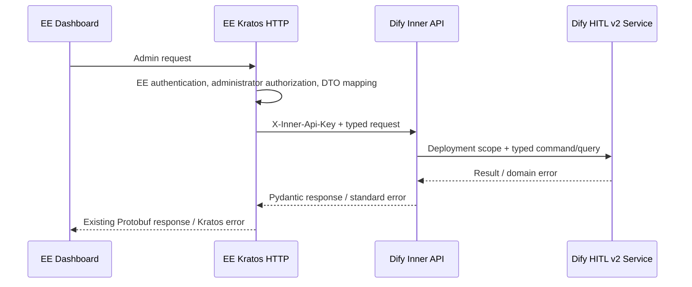

# HITL v2：EE 调用 Dify 的内部 API 设计

状态：供审阅的设计与 Python Stub，handler body 留空，HITL controller 尚未加入运行时加载列表。CE 基线为 `b59f83f78a4305c4b76579885b4bed789fa4c76f`。EE 参考工作区 HEAD 为 `adef5231063029e8b7830a1f777a706f5209051a`；其当前工作区中的 Proto 和 `docs/human-input-admin-api.md` 也作为只读输入。

## 1. 责任与范围

调用方向固定为：



EE Console 仅负责 EE 鉴权、已有 EE 审计、协议转换和 HTTP 转发。Dify 独占 Channel 配置、凭据合并与加密、provider 调用、Contact 投影与可用性、同步与调度、identity 和 binding 的业务与持久化。CE Console 继续直接调用相同的 Dify Service，不绕经 EE。

本设计覆盖现有 EE Proto 的 17 个操作。排除 Email Channel、workspace override、Platform/External Contact CRUD、member/workspace CRUD、自动同步、历史 run、取消同步和 binding 连通性测试。

关键不变量：

1. owner 固定为本部署的 `DeploymentScope()`；客户端不能指定 organization、workspace、tenant 或 Dify Account。
2. 同一部署最多一个当前 IM Channel；create 不做 upsert，普通 update 不做 replacement。
3. 编辑、删除、替换和已保存测试都使用已寻址 Channel ID 与 opaque `expected_config_version`；失败不能修改原状态。
4. 测试不保存配置、连接状态或版本，不触发同步。
5. Contact ID 独立于 workspace membership；`joined_at` 来自 `Account.created_at`。
6. 默认绑定只能选择当前 Channel 已同步的 `identity_id`；替换必须原子完成并保留 workspace overrides。
7. 同步复用 active run 时保留原发起人；Dify 不向 EE 反查管理员姓名。
8. 响应和错误不得含秘密值；EE 只做 DTO 转换，不读取已保存 secret 或重复业务判断。

## 2. 鉴权与上下文

### 2.1 复用现有 EE → Dify 鉴权

已有证据：

- CE `api/controllers/inner_api/wraps.py`：`enterprise_inner_api_only` 直接委托 `inner_api_only`。`INNER_API=false` 返回 404；启用后检查 `X-Inner-Api-Key == dify_config.INNER_API_KEY`，缺失或不匹配返回 401 `inner_api_unauthorized`。
- CE `api/controllers/inner_api/{runtime_credentials.py,app/file_grants.py}` 已使用这个 EE decorator。
- EE `server/pkg/difyclient/client.go:NewForConfig` 已把 `DifyConfig.ApiKey` 放进 `X-Inner-Api-Key`；`utils/net.go` 将相同 transport/header 交给 typed generated Inner client，基址为 `/inner/api`。

所有 Stub 方法均引用 `enterprise_inner_api_only`。本设计不新增密钥、JWT、签名或配置项；不使用 plugin/agent key、EE 的 `Enterprise-Api-Secret-Key` 或面向 EndUser 的 `enterprise_inner_api_user_auth`。EE Dashboard 的 cookie/JWT 不向 Dify 透传，也不构造 Console 登录态。

该机制是共享内部主密钥，**不能证明持有者只能是 EE**。旧 OpenSpec 要求的 caller-scoped service identity 无法由现有 wrapper 保证。本次依据用户明确的“已有 EE 调用 CE 鉴权则沿用”要求保留现状，不将其描述成更强的身份隔离。

### 2.2 EE 的权限与标识

EE 入口保留当前 Dashboard 的 JWT/cookie、session、CSRF、适用的 MFA/license 检查，并在转发前确认企业管理员权限。现有 `server/pkg/enterprise/server/http.go` 有上述 middleware，但 HITL service 尚未接线；不能把生成 HTTP handler 等同于已经完成权限检查。此处不复用 workspace admin/owner 或 Dify Console token 作为 EE 管理员权限。

普通请求不传播 human actor。唯一必要例外是创建同步：EE 从已认证的 `EnterpriseClaims.UserID` / `sys_users.id` 提取 UUID，写入内部 body 的 `started_by_sys_user_id`。该字段不进入 EE public request，不由浏览器选择；Dify 不创建对应 Account，也不把它用于权限提升。Channel 的 `configured_by_account_id`、默认 binding 的 `bound_by_account_id` 在部署写入时保持 null。

其余标识及上下文规则：

| 值 | 来源与传递 |
| --- | --- |
| Channel ID / Contact ID | 使用 Dify 返回的标识寻址；内部路径按 CE 的 UUID converter 表达。格式不匹配保持路由 404；EE 不生成或改写 ID |
| `identity_id` | 复用 CE `CreateIMBindingRequest` 的内部 identity 字符串；不是 `provider_user_id` 或 Contact ID |
| `expected_config_version` | 从 summary 原样回传；使用现有 `config_version.py` codec，绑定 IM kind、Channel ID 和 revision，不能自行解析或递增 |
| owner | Dify 依据受鉴权的部署级入口构造 `DeploymentScope()`；不接收 owner 参数，不虚构 tenant |
| correlation | EE 沿用现有 OpenTelemetry HTTP transport 传递 trace context；EE 自有 operation ID 保持在 EE 审计。它们均不是幂等键或业务参数，本设计不新增要求必填的 metadata header |

## 3. 路由与 Pydantic 契约

EE 列的相对路径统一加 `/v1/dashboard/api/integrations/im`；Dify 列统一加 `/inner/api/enterprise/human-input/v2`。这里采用 **当前 Proto 的实际路径**，不是 EE 设计文档中已过时的 `/human-input/*` 示例。

内部相对路径与 HTTP 方法沿用上游 Enterprise Proto 在 `/v1/dashboard/api/integrations/im` 后的定义，挂在 Dify 的 `/inner/api/enterprise/human-input/v2` 下：Channel 编辑使用 PATCH，动作使用 `:replace` / `:test`，同步结果使用 `/sync-runs/latest/records`。成功状态全部为 **200**，包括创建异步 run 和返回 `{binding_id}` 的绑定删除；不引入 201、202 或 204。

### 3.1 Channel（`im_channel.py`）

| EE RPC | EE HTTP | Dify HTTP | 内部 body / query | 内部成功响应 |
| --- | --- | --- | --- | --- |
| ListIMChannelProviders | GET `/channel-providers` | GET `/channel-providers` | 无 | `ListIMChannelProvidersResponse` |
| ListIMChannels | GET `/channels` | GET `/channels` | 无 | `ListIMChannelsResponse` |
| GetIMChannel | GET `/channels/{channel_id}` | GET `/channels/{channel_id}` | 无 | `IMChannelDetailResponse` |
| CreateIMChannel | POST `/channels` | POST `/channels` | `IMChannelCreatePayload` | `IMChannelMutationResponse` |
| UpdateIMChannel | PATCH `/channels/{channel_id}` | PATCH `/channels/{channel_id}` | `IMChannelUpdatePayload` | `IMChannelMutationResponse` |
| DeleteIMChannel | DELETE `/channels/{channel_id}` | DELETE `/channels/{channel_id}` | `IMChannelDeleteQuery` | `IMChannelDeleteResponse` |
| ReplaceIMChannel | POST `/channels/{channel_id}:replace` | POST `/channels/{channel_id}:replace` | `IMChannelReplacementPayload` | `IMChannelMutationResponse` |
| TestIMChannel | POST `/channels:test` | POST `/channels:test` | `IMChannelTestPayload` | `IMChannelTestResponse` |
| TestSavedIMChannel | POST `/channels/{channel_id}:test` | POST `/channels/{channel_id}:test` | `IMChannelUpdatePayload` | `IMChannelTestResponse` |

完整 credentials 和逐字段编辑复用 `controllers/common/human_input_v2/providers.py` 的 `IMProviderCredentialsInput` 与 `provider_updates.py` 的 `IMProviderCredentialsUpdateInput`，保持六种 provider、必填字段、`SecretStr`、Slack token 前缀及 Teams UUID 等既有约束。Console 与 Inner 都直接从 common 引用这组契约，Inner 不依赖 Console controller。保留既有 credential 边界校验；不在 Service 内再解析宽泛 JSON。部署 transport 要求、provider tenant 识别和凭据合并仍由 Dify 决定。

saved test 直接复用 `IMChannelUpdatePayload`，`credentials` 必填且不能为 null。只测试已保存版本时，提交当前 provider，并将每个可编辑字段显式设为 `{"type":"unchanged"}`；临时编辑使用相同 DTO 的替换值或可选字段 null。保留语义仅由字段级 `UnchangedInput` 表达，外层不另设省略或 null 分支。

读取 credentials 直接复用 common 下的 `provider_views.IMProviderCredentialsResponse`，只含 identifier、`Redacted` 和可选 null。`IMChannelSummary` 是 CE `ChannelSummary` 的 IM 专用收窄：固定 `kind=im`、`provider: IMProvider`、三个持久化 IM status；不接受 Email，也不出现仅用于 Email 的 `configured`。Inner 自有 envelope 不导入会注册 CE handler 的 `channel.py`。

返回空 `channels` 表示未配置；list 最多一项。读取不测试 provider、不自动同步、不修复 Contact。配置不存在、已删除、被替换或不属于当前部署的 ID 均 404。

创建、替换及新配置测试需要完整凭据。普通编辑保留 Channel ID；provider 或 provider tenant 改变返回 `replacement_required`，不能自动改用 replacement。替换成功产生新 Channel ID，旧 identities、默认绑定、overrides 与结果不再作为当前数据返回；删除同样使旧数据退出当前查询。两者都不自动触发同步。

### 3.2 Contact 与默认绑定（`contact.py`）

| EE RPC | EE HTTP | Dify HTTP | 内部 body / query | 内部成功响应 |
| --- | --- | --- | --- | --- |
| ListContacts | GET `/contacts` | GET `/contacts` | `ListOrganizationContactsQuery` | `ListOrganizationContactsResponse` |
| GetContact | GET `/contacts/{contact_id}` | GET `/contacts/{contact_id}` | 无 | `GetOrganizationContactResponse` |
| ListIMIdentities | GET `/identities` | GET `/identities` | CE `ListIMIdentitiesQuery` | CE `ListIMIdentitiesResponse` |
| SetContactIMBinding | PUT `/contacts/{contact_id}/bindings` | PUT `/contacts/{contact_id}/bindings` | CE `CreateIMBindingRequest` | `SetOrganizationIMBindingResponse` |
| DeleteContactIMBinding | DELETE `/contacts/{contact_id}/bindings` | DELETE `/contacts/{contact_id}/bindings` | 无 | Inner `DeleteIMBindingResponse`（`{binding_id}`） |

`OrganizationContact`、binding 摘要与详情字段以 Stub 为准。它与 CE workspace Contact 的必要差异是：没有 workspace-relative `type`、`group` 或 override，`joined_at` 取代以 Contact 创建时间表达加入时间的错误做法。`email` 保留 CE 的 nullable 语义，EE 在非 optional Protobuf string 上转成空串。

Contact list/detail 查询当前可用 Account-backed projection；不可用 Account 从列表省略、按 ID 返回 404。单个 workspace 的加入/退出不改变 Contact ID。读和同步均不执行初始化或修复；这些属于已有升级与 Contact 生命周期维护。

identity 查询只接受 `keyword/page/limit`；provider 与 Channel 由 Dify 确定。`keyword` 匹配 provider user ID、display name 或 email。没有 Channel 返回 404；有 Channel 未同步时返回空集合。bound/unbound 只反映 Organization 默认绑定，不把 workspace override 复用当成全局冲突。

PUT 原子替换目标 Contact 和所选 identity 已占用的默认绑定，保留 workspace overrides；相同赋值保留 Binding ID，实际重绑产生新 ID；失败保留原绑定。返回更新后的 `{contact}`，不增加 identity 详情。DELETE 仅删除默认绑定；不存在返回 404，成功在事务提交后返回 200 `{"binding_id":"<deleted-binding-id>"}`。`binding_id` 必须来自实际删除的 binding，不能用 Contact ID 或 identity ID 代替。该响应 DTO 归属 Inner controller；当前 CE 的空响应契约继续独立使用。

### 3.3 手动同步（`im_sync.py`）

| EE RPC | EE HTTP | Dify HTTP | 内部 body / query | 内部成功响应 |
| --- | --- | --- | --- | --- |
| CreateIMSyncRun | POST `/sync-runs` | POST `/sync-runs` | `CreateDeploymentIMSyncRunPayload` | `DeploymentIMSyncRunResponse` |
| GetLatestIMSyncRun | GET `/sync-runs/latest` | GET `/sync-runs/latest` | 无 | `DeploymentIMSyncRunResponse` |
| ListLatestIMSyncRunResults | GET `/sync-runs/latest/records` | GET `/sync-runs/latest/records` | CE `ListLatestIMSyncRunResultsQuery` | CE `ListLatestIMSyncRunResultsResponse` |

创建 body 仅含 EE 注入的 `started_by_sys_user_id`。Dify 使用现有 `SysUserIMSyncInitiator` 创建或复用当前 Channel revision 的 queued/running run，不接受 caller 指定 provider、revision 或 run ID。复用 run 时不能用当前请求的 actor 覆盖原发起人。

`DeploymentIMSyncRun` 继承 CE `IMSyncRun`，唯一新增字段是持久化的 `started_by_sys_user_id`。若该字段非 null，EE 查询该 **原 run 的** sys_user 姓名；用户已删除或不可用时显示空串，不回退到当前请求管理员。Dify 对 EE initiator 的 `initiator_display_name` 固定为空。字段为 null 时表示既有领域模型支持的 Account initiator，保留 Dify 返回的 `initiator_display_name`；不引入第二种创建请求或暴露 Account ID。姓名不持久化在 run，Dify 不回调 EE 查名。

run 的 `channel_config_version` 是捕获时的数字 revision，不是配置写入的 opaque token。`started_at` 在未执行时为 null，`finished_at` 在未完成时为 null；UI 用后者作为同步时间。沿用 CE status、counts 和 error_message 字段。

结果页直接复用 CE 五种 discriminated union：`added / not_matched / failed / removed / skipped`；必须选一个 bucket，不接受 `all`。每个条目为 `{id, result}`，result 内含 `type` 和对应字段。removed 保留三种 `IMSyncRemovalReason`；Contact snapshot 的 `created_at` 是 Contact 创建时间，其 nullable email 是冻结值，不应替换为当前 Contact 查询。未匹配条目不创建 Contact。

latest summary 和结果独立读取，不承诺跨请求固定同一 run。单页 data 与 total 对应同一被选中的 run/bucket；结果不重复 run summary、不增加 run_id 或 cursor。没有 Channel 为 404；当前 Channel 没有 run 也为 404。

## 4. EE 转发转换规则

这是 EE façade 所需的完整传输转换，不包含业务判断或存储访问。映射基于当前 `{im_channel,contact,im_sync}.proto`：

| EE 表达 | Dify 内部表达 |
| --- | --- |
| lowerCamelCase ProtoJSON、Protobuf enums | snake_case JSON、现有 CE 小写 enum 值；显式映射六种 provider（包括 `DING_TALK → ding_talk`、`MS_TEAMS → ms_teams`、`WE_COM → we_com`），不通过字符串猜测 |
| credentials oneof `feishu/lark/slack/ding_talk/ms_teams/we_com` | 同名 CE provider discriminator + 对应完整/编辑字段；Feishu 与 Lark 保持不同 provider |
| create/replacement/new test 的可选 secret 空串或缺失 | `verification_token/encrypt_key/app_token` 转为 `null`；必填 secret 空串不映射成保留 |
| update 的非空 FieldMask | mask 外每个叶子字段显式变成 `{"type":"unchanged"}`，忽略其输入值；mask 内有效值原样替换，可选 secret 空串/缺失转 null |
| mask 无效路径、`*`、provider 根路径、跨 provider 路径、空 mask | EE 拒绝；仅允许所选 provider 的已知叶子字段。内部接口本身不接受 FieldMask 或缺失编辑字段 |
| saved test 不修改任何凭据 | 内部复用 `IMChannelUpdatePayload`，提交 provider，并将每个可编辑字段设为 `{"type":"unchanged"}`；credentials 本身必填且不能为 null |
| saved test 同时提交 credentials 与 mask | 与 update 相同的字段转换；只提交其中之一或空 mask 拒绝 |
| `page=0` / `limit=0` | EE 分别转换成 1 / 20；内部 Pydantic 只接受 page≥1、1≤limit≤100，省略时同样默认 1/20 |
| Channel create/update/replacement 的 `{summary}` | EE 取 summary，直接返回 Proto `IMChannel` |
| 内部 binding DELETE 的 `{binding_id}` | 当前 EE `google.protobuf.Empty` 响应编码为 `{}`，不向 Dashboard 输出该 ID；内部调用方可以取得实际删除的 binding ID |
| `{im_providers:[{provider,connection_mode}]}` | EE 仅投影 `providers` enum 列表；内部 IM Channel 的固定 `kind` 和 `connection_mode` 不进入 EE 响应 |
| credentials 的 `Redacted`、可选 null | EE 只保留非秘密 identifier；可选 secret 非 null 映射 `has_*=true`，null 映射 false；绝不读取或回传 secret |
| `Timestamp` | Dify 按现有 `fields.timestamp.Timestamp` 从 datetime 序列化为 UTC Unix 整数秒，null 保持 null；EE 转 `google.protobuf.Timestamp`，不能把秒误作毫秒 |
| `webhook_url=null`、nullable email/display_name | 对应非 optional Proto string 使用空串；optional string/message 保留 presence |
| sync result 的 `result.type` | 选中相应 Protobuf result oneof，逐字段转换，不补出其他 bucket 字段 |
| 内部 run 的 `started_by_sys_user_id` | EE 用其查名后不向 public response 暴露该 ID |

每个 EE RPC 对应一次 Dify HTTP 调用；EE 不先读取配置来补齐业务输入。saved test 的全字段 unchanged 请求可直接使用现有 `IMChannelService.test_saved` 的字段级编辑契约，无需增加外层 null 适配。EE Proto 原先允许同时省略 credentials 与 mask 的输入无法直接映射该内部请求，EE 契约需要同步明确 provider 与字段级保留表达。

EE 新配置示例映射成内部请求：

```json
{
  "credentials": {
    "provider": "feishu",
    "app_id": "cli_example",
    "app_secret": "<new-secret>",
    "verification_token": null,
    "encrypt_key": null
  }
}
```

只替换 Slack client secret 的内部 update 示例：

```json
{
  "expected_config_version": "<opaque-token-from-summary>",
  "credentials": {
    "provider": "slack",
    "client_id": {"type": "unchanged"},
    "client_secret": "<new-secret>",
    "signing_secret": {"type": "unchanged"},
    "bot_token": {"type": "unchanged"},
    "app_token": {"type": "unchanged"}
  }
}
```

Pydantic `SecretStr` 的默认 JSON serialization 会掩码。EE 实现必须显式序列化允许发送的输入 secret 原值；不得将 `**********` 当作实际凭据转发。Dify 响应使用独立 redacted DTO，不对请求 DTO 直接 dump 后返回。校验错误也不能记录原 body 或 `ValidationError.errors()` 中的 input。

## 5. 错误契约

所有非成功响应复用 Stub `contracts.APIErrorResponse`（继承现有 `libs.external_api.ErrorResponse`），核心字段为 `{code, message, status}`；既有通用校验错误的可选 params/details 继续沿用。未来 handler 抛出或转换 HTTP exception，由现有 ExternalApi 输出该模型；本次不实现异常转换器。EE 根据 **operation + code + status** 映射 `enterprise_error.proto`，不解析 message 文本。

| 内部 HTTP / code | 适用操作 | EE reason / 行为 |
| --- | --- | --- |
| 普通 404（`INNER_API=false`） | 全部 | 与资源 404 可能同形，不能仅凭响应可靠区分未启用；沿用现有按 operation 的错误处理，部署接线需先确认 INNER_API 配置 |
| 401 `inner_api_unauthorized` | 全部 | EE→Dify 配置/凭据错误；不能触发浏览器重新登录或转述成 EE 管理员权限不足 |
| 400 `invalid_param` / `bad_request` | 输入、版本格式/Channel-ID 不匹配、凭据或 saved test provider 不匹配 | EE 既有通用 400；不增加业务 reason |
| 404 `not_found` | Channel get/update/delete/replace/saved test | `HUMAN_INPUT_CHANNEL_NOT_FOUND` |
| 409 `conflict` | Channel create | `HUMAN_INPUT_CHANNEL_ALREADY_CONFIGURED` |
| 409 `provider_configuration_updated` | Channel CAS 操作 | `HUMAN_INPUT_PROVIDER_CONFIGURATION_UPDATED`；刷新后由用户重新应用，不自动重试 |
| 409 `replacement_required` | Channel update | `HUMAN_INPUT_REPLACEMENT_REQUIRED`；必须显式 replacement |
| 404 `im_integration_not_configured` | sync、identity、binding | `HUMAN_INPUT_CHANNEL_NOT_CONFIGURED` |
| 404 `not_found` / `contact_not_found` | Contact detail / binding command | `HUMAN_INPUT_CONTACT_NOT_FOUND` |
| 404 `im_identity_not_found` | binding PUT | `HUMAN_INPUT_IM_IDENTITY_NOT_FOUND` |
| 404 `im_binding_not_found` | binding DELETE | `HUMAN_INPUT_IM_BINDING_NOT_FOUND` |
| 409 `im_binding_conflict` | binding PUT | `HUMAN_INPUT_IM_BINDING_CONFLICT` |
| 404 `im_sync_run_not_found` | latest summary/results | `HUMAN_INPUT_IM_SYNC_RUN_NOT_FOUND` |
| 409 `im_sync_revision_changed` | sync create | `HUMAN_INPUT_IM_SYNC_REVISION_CHANGED` |
| 503 `im_sync_dispatch_unavailable` | sync create | `HUMAN_INPUT_IM_SYNC_DISPATCH_UNAVAILABLE`；queued run 可能已提交 |
| 503 `im_write_unavailable` | 既有 CE controller 的保护性捕获 | 保留内部错误，EE 使用既有上游故障映射；当前生产代码没有抛出路径，不分配新的 HITL reason |
| 422 `invalid_im_binding_scope` | 既有 workspace-only binding service | 是部署级入口尚未适配的实现缺口；不能让 EE 增加 tenant 参数绕过，不作为该部署 API 的合法业务结果 |
| 其他 5xx、timeout、网络错误、响应解码失败 | 全部 | EE 既有 sanitized upstream failure；不泄露 body、secret 或内部异常 |

两种 Channel 测试的预期 provider 拒绝继续返回 HTTP 200，body status 为 `invalid_credentials` / `connection_failure`；成功为 `connected`。同类失败在保存配置时仍为 400。不存在 ID 为 404；语法合法但过期的配置版本为 409。字段和 codec 校验不替代 Service 的业务/CAS 判断。

GET 可以按现有 client policy 有限重试。写操作的 timeout 不等于未提交；没有 operation 去重契约时不自动重放，先读 current/latest，再由调用方决定。相同 binding 赋值保留 ID、同步 active-run 复用不构成任意 HTTP mutation 的通用重试保证。

## 6. 文件、接线与实施依赖

Python Stub 位于现有的 `api/controllers/inner_api/human_input_v2/`：`contracts.py` 声明请求/错误模型；`im_channel.py`、`contact.py`、`im_sync.py` 直接使用 `controllers.inner_api.inner_api_ns` 声明 Flask-RESTX `Resource`、路由和 schema。17 个 handler 均引用既有鉴权 decorator，body 只有 docstring 和 `...`。

Console 与 Inner 共用的完整凭据、编辑凭据、脱敏响应及严格请求基类位于 `api/controllers/common/human_input_v2/{providers,provider_updates,provider_views,_common}.py`。原 Console 模块已迁移，调用方直接引用 common；不保留旧位置的转发或重导出。各入口的路由、鉴权和入口专用 envelope 仍由自己的 controller 拥有。

handler 参数只接收 Flask URL converter 实际传入的路径变量，例如 `get(self, contact_id: UUID) -> GetOrganizationContactResponse`；没有路径变量的方法只接收 `self`。body/query DTO 通过 `expect`、`query_params_from_model` 声明，不放进 handler 参数伪装成自动注入。Stub 的返回注解直接使用具体 Pydantic 响应 DTO，并与 `response` 声明一致。类型注解不执行序列化；实际实现需要完成请求解析及 HTTP 响应序列化。

复用现有 `controllers.inner_api` Blueprint 和 `inner_api_ns`，不创建另一套 controller 根包或 Namespace。Blueprint 已提供 `/inner/api` 前缀，HITL route decorator 直接声明 `/enterprise/human-input/v2/...`。`human_input_v2/__init__.py` 不重导出或自动导入 handler；`inner_api._register_controllers()` 暂不加载这些 Stub。方法实现完整后只需将这三个 controller 模块加入现有加载列表。

上线前必须补齐的实际依赖，不在本次设计任务中实现：

| 依赖 | 代码证据与边界 |
| --- | --- |
| Deployment Channel service / cipher | `IMChannelService` 已有公共实现，具体 composition 仅有 `WorkspaceIMChannelService`；已有 `DeploymentIMChannelReader/Writer` 不等于部署 service/cipher 已就绪。`human-input-v2-im-control-plane-core` 明确要求显式注入 deployment-bounded cipher，不允许从 `SECRET_KEY`、instance ID 或假 tenant 推导 |
| Organization Contact list/detail | `ContactManagementService`、Contact repository 当前依赖 tenant/workspace 查询；需要 Dify-owned 部署投影与 Account 加入时间，不可在 EE join shared DB 或用某个 workspace 查询代替 |
| Deployment binding command / response | `ContactIMBindingService` 的 `_tenant_id(DeploymentScope())` 明确拒绝，PUT 也要求 tenant 并读取 effective workspace binding；部署实现必须返回 Organization 默认绑定，不能伪造 tenant 或误返 override |
| Deployment sync composition | `im_contact_sync/composition.py` 需要 deployment Contact reader/adapter 注入；只有通用 sync Service 不代表 deployment runtime 已配置。sys_user initiator 持久化和互斥约束已经存在，无需为本 API 新增持久化字段 |
| EE Saved test 的无编辑输入 | EE Proto 原先允许同时省略 credentials 与 mask；需同步为能明确 provider 与字段级保留指令的请求，不给 Dify DTO 增加外层省略或 null 分支 |
| EE façade wiring | Proto/generated handler 已存在，当前没有 HITL service registration/实现。EE typed client、鉴权接线与上述 DTO 转换须后续完成 |

本任务遵循用户指定的 HITLv2 Session 规则：Service/Controller 拥有事务生命周期，Repository 使用注入的 Session，不创建/关闭/commit/rollback。基线通用架构文档中相反的 repository-owned Session 默认值不覆盖用户明确规则。Stub 不访问任何数据库，也不为便利新增 Repository operation。

## 7. OpenSpec 依据、冲突及设计待决点

已通过 `openspec store list --json`、`context/list --store dify-specs` 和 `status --store dify-specs --change implement-ee-human-input-admin-api --json` 解析规范位置，读取相应 main spec 及 active change。规范库位于 `/Users/qg/workspace/langgenius/dify-specs`。

| 来源 | 本设计处理 |
| --- | --- |
| main `human-input-ee-admin-api`、`human-input-v2-im-control-plane-core` | 采用当前显式 create/update/replacement、latest-only、Organization Contact 与 Dify 唯一业务 owner；同步发起人遵循已有 sys_user 模型与主规范 |
| main `human-input-v2-im-channel-service`、CE channel/provider/config_version 代码 | 复用完整/编辑 credential、opaque CAS、纯测试和 deployment-owned transport；不加 mode 字段 |
| main `human-input-console-management-api`、CE common contracts/contact controller | 复用分页、identity、sync result、默认绑定语义；workspace-relative Contact 与鉴权不套到部署入口 |
| main `human-input-channel-management-console-api` 的 provider DTO ownership 条款 | 已同步为 `controllers/common/human_input_v2/` 拥有共用契约，Console 与 Inner 直接依赖 common。字段、校验、转换和脱敏语义不变；该规范更新随本次代码重构一并提交 |
| active `implement-ee-human-input-admin-api` 的旧 proposal/design/transport delta | 仍写十二个 RPC、旧 `/human-input/*`、Upsert、optional-secret omission、禁止传播 EE User ID、要求独立 caller identity。与当前 Proto、主规范和用户复用鉴权指令冲突；不采用这些旧约束 |
| 同 active change 的 contact-binding delta | 仍要求 provider query、name/email 独立过滤与 TestIMBinding；当前 EE Proto 和 CE 能力都不支持，不增加这些接口 |
| 同 active change 的 sync-adapter delta | 已更新为传递并返回 `started_by_sys_user_id`，与现有 domain/model/service 一致；采用该条，而不是同 change 的过时禁止条款 |
| EE `docs/human-input-admin-api.md` | FieldMask/空串/脱敏语义仍有效；其中路由示例已落后于当前 Proto，路由以 Proto 为准 |

代码与设计产物位于本次独立工作区；提交时一并同步外部规范库中的共用 DTO 归属条款。其余未实现的 API 设计不写成现行 main spec；上述冲突已记录，实施该 API 时需一并修订相应 OpenSpec，不能沿用旧 checklist 直接声称已完成。

没有需要扩展业务范围才能完成本次 Stub 的待决点。后续实现必须解决的设计选择只有 deployment-bounded cipher 的提供方式；其余表中项是已知实现依赖。共享 Inner key 的身份隔离限制是用户已指定复用机制的实际边界，若将来要求 EE 独占调用身份，应单独变更鉴权契约。

## 8. 验证范围

已完成以下检查，均通过：

- Ruff lint/format 覆盖 `api/controllers/common/human_input_v2/`、Console `channel.py`、Inner `human_input_v2/`，11 个 Python 文件通过。
- `uv run --project api --active --no-sync pyrefly check --threads 2 --config api/pyproject.toml api/controllers/common/human_input_v2 api/controllers/console/human_input_v2/channel.py api/controllers/inner_api/human_input_v2`：0 diagnostics。
- 通过同一 `uv run --project api ... python` 执行内联检查：Python 语法、模块导入和 Pydantic validation/serialization JSON Schema 均可解析。
- 24 个凭据 DTO 的 validation/serialization Schema 与迁移前完全相同；迁移后的 class/function/type alias 定义保持不变。Console 和 Inner 引用同一份 common 类型，共用模块和 Inner 均没有 Console import，旧 Console 模块引用已清理。
- 检查 17 个 Resource handler 的实际路由变量与 Python 参数一一对应、请求/响应 schema 声明完整、body 留空，且 HTTP 方法及相对路径与 EE Proto 一致；所有模块使用既有 `inner_api_ns`，默认 controller 加载列表不加载 HITL Stub。
- 使用 `uv run --project api --active --no-sync pytest -q` 运行现有的 channel provider/API/wire/OpenAPI、Feishu/Lark credentials/SDK boundary、Teams/WeCom credential alignment 和 IM Channel service 单元测试：242 passed。

检查以 `VIRTUAL_ENV=/Users/qg/.codex/worktrees/5ab7/dify/api/.venv` 只读复用现有 Python 3.13/dependencies，使用 `--active --no-sync`，没有安装或同步依赖；导入检查设置 `PYTHONDONTWRITEBYTECODE=1`、`PYTHONPATH=api` 和 `HUMAN_INPUT_IM_EVENT_TRANSPORT_MODE=WEBHOOK`，没有修改部署配置。上述后置条件仅是设计 Stub 的类型/Schema 可解析和未接线，不表示 provider、数据库、鉴权 HTTP 响应或端到端业务已验证。未运行集成测试，也未为未实现方法添加业务测试。
