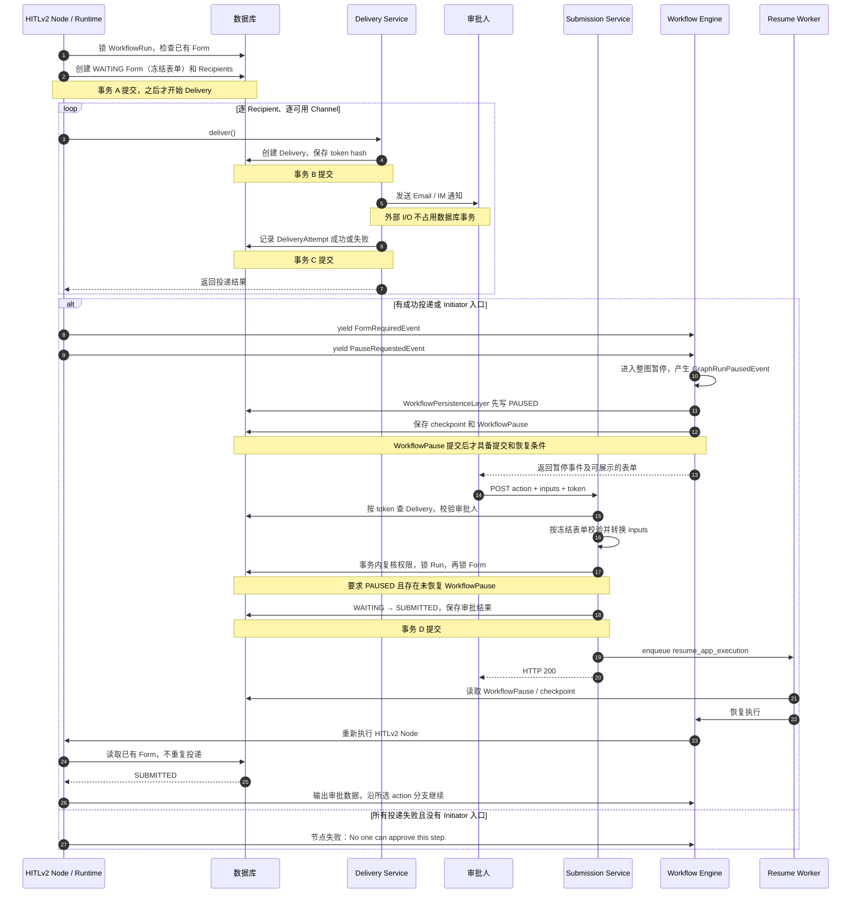
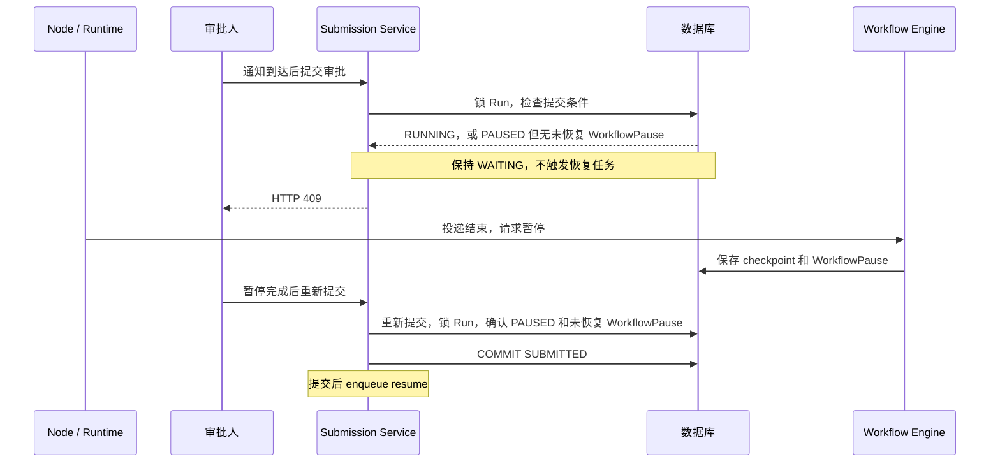

# HITLv2 Form 创建、投递、暂停与提交时序

本文根据 2026-10-08 当前工作区实现梳理运行流程。提交部分以已实现的 Console submission 为准，不代表 Email OTP、IM callback 或 Web App 提交入口均已完成。

本文记录现状，不定义新的设计要求。交错窗口的结论来自静态调用链分析，未进行并发复现。

## 核心顺序

当前主顺序为：

**提交 Form 和 Recipients → 同步投递通知 → 请求暂停 Workflow → 持久化 checkpoint 和 WorkflowPause → 接受提交。**

Submission 只接受 `PAUSED` 且已有未恢复 WorkflowPause 的 Workflow。通知可能先于暂停落地到达；此时提交返回 HTTP 409，不保存审批结果，也不触发恢复任务，审批人可以在暂停完成后重新提交。首次投递结束后不再重读 Form。

## 主流程时序图



图中 Email / IM 表示通知发送。提交路径仍以 Console 鉴权入口为准；具有其他 `SubmissionAuthType` 的 Delivery 不能通过该入口提交。

## 1. Form creation

`HumanInputFormService.prepare_form()` 在事务内先锁定所属 `WorkflowRun`，再按 workflow run 和 node execution 查询已有 Form。

- 首次执行：编译并冻结 `ResolvedForm`，计算截止时间，解析并创建 Recipients，然后提交同一个事务。
- 已有 Form：返回持久化状态；存在 Current Initiator Delivery 时恢复其 token，不重新初始化 Recipients 或投递通知。
- 只有完成首次初始化的调用方拿到 `CreatedForm`，由 Runtime 继续执行首次投递。

**Form 和 Recipients 原子提交；Delivery 不包含在这个事务中。**

## 2. Delivery

`DifyHumanInputRuntime.prepare_form()` 收到 `CreatedForm` 后，逐个调用 `HumanInputDeliveryService.deliver()`。当前发送在节点执行调用链中同步进行，并非先暂停、再由后台任务统一发送。

对每个实际发送的外部渠道，顺序为：

1. 创建 Delivery，保存目标快照、认证类型和 token hash，提交事务。
2. 在数据库事务外执行 Email / IM provider I/O。
3. 在另一个事务内记录 DeliveryAttempt 成功或失败。

Current Initiator 是特殊入口：创建 Delivery/token，但不发送外部通知，也不产生外部发送 Attempt。可用的 Initiator token 本身就能支持节点进入等待。

整轮投递结束后，Runtime 根据投递结果返回初始化时的 Form：

- 至少有一次成功投递或可用 Initiator token：进入暂停路径。
- 所有投递失败且没有 Initiator token：节点失败，错误为 `No one can approve this step.`。

**投递期间的提交会被拒绝。** Runtime 等整轮调用结束后请求暂停，审批只能在暂停落地后被接受。恢复时读取已有 Form，消费已提交的审批结果，不重复投递。

## 3. Workflow suspension

节点读取到 `WAITING` 后，依次 yield：

1. `NodeRunHumanInputV2FormRequiredEvent`，携带已准备好的表单。
2. `PauseRequestedEvent`，携带用于恢复的 `HitlRequired` 引用。

`FormRequiredEvent` 并不表示 Workflow 已完成暂停。当前 Runner 先缓存表单，待收到 `GraphRunPausedEvent` 后才发布暂停和表单展示信息。

暂停持久化过程保存 graph runtime checkpoint 和恢复上下文，并创建 `WorkflowPause`、设置 WorkflowRun 为 `PAUSED`。checkpoint 内容通过 storage 保存，数据库记录保存其引用；它们不应被理解为与 Form creation 共用一个原子事务。

`WorkflowPersistenceLayer` 会先写入 `PAUSED`，随后 `PauseStatePersistenceLayer` 才保存 checkpoint 和 WorkflowPause。因此 `PAUSED` 本身不能证明暂停已准备完成；Submission 在写事务中还检查未恢复 WorkflowPause 是否存在。

V2 的暂停引用保存在 graph checkpoint 中；旧 `workflow_pause_reasons` 明细只镜像 V1。

## 4. Form submission 与恢复

当前 Console 提交接口为：

```text
POST /console/api/form/human-input/v2/<form_token>
```

提交顺序为：

1. 根据 token hash 查询 Delivery，要求其 `SubmissionAuthType` 为 `CONSOLE`。
2. 校验当前 Account 对应的 Contact 是该 Delivery 的 Recipient，并校验所属 Form 和租户关系。
3. 根据冻结的 `ResolvedForm` 校验 action、字段和文件，并生成内部 Segment 数据。可能涉及外部 I/O 的文件重建在写事务外进行。
4. 开启写事务，复核权限，先锁 WorkflowRun，再锁 Form。
5. WorkflowRun 必须为 `PAUSED`，且存在已提交、未恢复的 WorkflowPause；Form 必须仍可提交且未超过截止时间。
6. 写入 `SUBMITTED`、审批人、action、原始输入和规范化数据，提交事务。并发提交由锁和状态检查保证只接受第一份。
7. 事务提交后调用 `resume_app_execution.apply_async()`。
8. 恢复任务读取 WorkflowPause/checkpoint，恢复 graph，并重新执行 HITLv2 Node。
9. 节点读取已有的 `SUBMITTED` Form，输出审批数据，沿所选 action 对应的分支继续，不重复投递。

**提交成功和 Workflow 恢复完成是两个阶段。HTTP 200 不表示恢复任务已经执行完毕。**

## 事务与外部副作用边界

| 阶段 | 提交内容 | 提交后的动作 |
| --- | --- | --- |
| Form creation | Form、Recipients | 开始首次投递 |
| Delivery 创建 | Delivery、目标快照、token hash | 发送外部通知 |
| Delivery 结果 | DeliveryAttempt | 继续其余投递，最后根据投递结果请求暂停或失败 |
| Workflow suspension | WorkflowPause、PAUSED 状态；checkpoint 另存 storage | 对外发布暂停及表单信息 |
| Form submission | SUBMITTED、审批人、action、输入数据 | 向 Celery 投递恢复任务 |

数据库提交、外部通知发送、checkpoint storage 和 Celery 入队之间没有一个覆盖全流程的原子事务。

## 当前时序窗口

### 通知到达后、暂停落地前提交

提交准入覆盖 `RUNNING` 和 `PAUSED` 但 checkpoint 尚未落地的情况：



过早提交不会消费审批机会。只有恢复所需的暂停记录已经落库，才会保存审批结果并触发恢复，从而封闭审批先提交、恢复任务先于暂停落地执行的窗口。

### Submission 已提交、恢复任务尚未入队时中断

审批数据提交后才调用 Celery。如果进程在两者之间崩溃，或者入队失败，审批结果仍已落库，但恢复任务可能没有产生。当前提交路径没有覆盖这两步的原子投递保障；再次提交同一表单会被视为重复提交，不能把它当作可靠的恢复入队重试。

### Form 初始化后或通知发送中途中断

当前实现重入时只读取已有 Form，不自动补发通知：

- Form 已提交、首次投递尚未开始时中断：重入不会补上首次投递。
- 一部分通知已发出时中断：重入不会继续剩余投递。
- Provider 已接受消息、Attempt 尚未提交时中断：可能留下外部已发送但本地未记录成功的状态。

这是当前代码行为；不能将其描述为“自动补发尚未确认成功的投递”。

## 代码入口

- [Form 初始化与重入读取](../api/services/human_input_v2/form_service.py)：`HumanInputFormService.prepare_form()`。
- [运行时编排](../api/services/human_input_v2/runtime.py)：`DifyHumanInputRuntime.prepare_form()`。
- [Delivery](../api/services/human_input_v2/delivery_service.py)：`deliver()`、`_prepare_delivery()`、`_record()`。
- [节点状态分支和事件](../api/core/workflow/nodes/human_input_v2/node.py)：`HumanInputNode._run()`。
- [Runner 事件处理](../api/core/app/apps/workflow_app_runner.py)：`_handle_event()`。
- [暂停持久化](../api/core/app/layers/pause_state_persist_layer.py)：`PauseStatePersistenceLayer.on_event()`。
- [WorkflowPause 存取](../api/repositories/sqlalchemy_api_workflow_run_repository.py)：`create_workflow_pause()`、`get_workflow_pause()`。
- [Console 提交入口](../api/controllers/console/human_input_v2/form.py)：`ConsoleHumanInputV2FormApi.post()`。
- [Submission](../api/services/human_input_v2/submission_service.py)：`submit_console_form()`。
- [Form 提交存储](../api/repositories/human_input_v2/sqlalchemy_form_repository.py)：`submit_form()`。
- [恢复任务](../api/tasks/app_generate/workflow_execute_task.py)：`_resume_app_execution()`。
- [V2 超时扫描](../api/tasks/human_input_timeout_tasks.py)：`check_and_handle_human_input_v2_timeouts()`。
