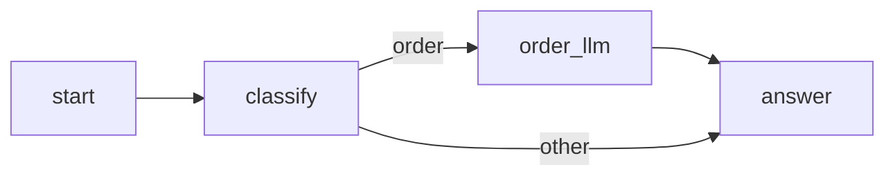

# Plan phase

Start only when the human has approved `spec.md`. The plan phase ends when the human approves `difyctl/<app-slug>/plan.md` and chooses how to build.

## How to plan

`<app_mode>` is `workflow` for a Workflow app and `advanced-chat` for a Chatflow app. `<mode>` is `workflow` or `advanced_chat`.

1. Ask the human: "Add notes on the canvas that explain each module?" On a yes, also ask which author name the notes show. Record both in `plan.md`.
2. Turn each spec step into nodes. Pick each one from `difyctl get node_option --app-mode <app_mode> --json`, the canvas "add node" menu. Narrow it with `--kind` (`block`, `tool`, `agent`) and `--keyword <words>`, and follow the next-page hint. Use only what it lists. To see a node type's fields, seed and handles, run `difyctl describe node_type --node-type <type>`. Add `--include-schema` only when you need a nested field's full shape.
3. Settle every config in full, so the build only changes format:
   - LLM: model, prompt text and outputs, and `reasoning_format: separated` on every LLM node. When a later step needs fields from the reply, prefer the LLM's structured output (`structured_output_switch_on: true` and `structured_output: {schema: <JSON schema>}`) and read `{{#<llm_id>.structured_output.<field>#}}`, over parsing the text in a Code node.
   - If-else: conditions, and where each branch goes.
   - Tool: the tool's row from `get node_option --kind tool`, and a value for every parameter `difyctl get tool --provider <id>` lists. Never guess one.
   - Agent: the roster Agent's row from `get node_option --kind agent`, and its task.
   - Human input: the form, the actions, the timeout, and where each action and `__timeout` goes.
   - Code: the code itself.
   - End: each output reads a variable. For fixed text, such as an error message, add a template node and read its output.
   - How the app starts (Workflow): a person, through the Start node, or a trigger instead: a schedule (`trigger-schedule`) or a webhook (`trigger-webhook`), from `get node_option --kind block`. A webhook answers its caller only with a fixed reply; the app's output is in its runs, not sent back. A trigger-started app can't be run from its web app, the Service API or `difyctl run`; list its runs with `difyctl get run --app-id <app_id> --triggered-from schedule` (or `webhook`, `plugin`).
   - Variable references, written as `{{#node_id.var#}}`.
4. With notes, group the nodes into modules, and write one note per module: its text, its theme (`blue`, `cyan`, `green`, `yellow`, `pink` or `violet`) and the top-level nodes it covers.
5. Draw the node-level Mermaid graph with real node ids, every edge, and a label on every branch.
6. Cut the build into slices. Each slice is small and connected, and imports and runs on its own. Slice 1 is the skeleton: start → end (Chatflow: start → answer; set the starter `llm` node's model or remove it and rewrite `answer`) with the final inputs and outputs. A note goes in the slice that adds the last node it covers.
7. Map the tests: a `difyctl test node <mode>` call with inputs for each new node, and a full draft run (`difyctl test console_app <mode>`) at the end of each slice on the cases it can pass.
8. Check coverage. Every requirement maps to a node and a test. Every branch, including an error or fallback branch, has a test whose input takes it, such as a node test with an unreachable URL. Some tools report a failure as success, and only such a test shows it. Every resource is confirmed, and each chosen plugin is installed and configured. An open resource blocks approval.
9. Ask the human to review the plan, and to choose how to build:
   - you build it alone; or
   - one fresh subagent per slice, one after another, given the slice text, the file paths and the `app_id`. A reviewer subagent checks each slice. Never run two on one app at once: their imports collide on the draft hash.

## Template

Copy this into `plan.md` and fill it in. Leave out the Notes section when the human said no to notes.

````markdown
# <App name>: plan

App: <name>. Mode: <workflow or advanced_chat>. `app_id`: <filled in at build>. Spec: spec.md.
Canvas notes: <no, or yes with author "<name>">.

## Node graph



## Node table

| Id        | Type | Version | Title       | Config                                               | Inputs used       | Outputs | Covers |
| --------- | ---- | ------- | ----------- | ---------------------------------------------------- | ----------------- | ------- | ------ |
| order_llm | llm  | 1       | Order reply | model: <provider>/<model>; system prompt: "<prompt>" | `{{#sys.query#}}` | text    | R1     |

## Notes

| Id          | Text                                              | Theme | Covers              |
| ----------- | ------------------------------------------------- | ----- | ------------------- |
| note_orders | Orders: sort the question, answer order questions | blue  | classify, order_llm |

## Slices

- [ ] Slice 2: add `classify`, `order_llm` and note `note_orders`. Covers R1. Node tests: `order_llm` with query "Où est ma commande ?". Full run: A1. Runs: <run ids>

## Test map

- A1: `test console_app advanced_chat`, query "Où est ma commande ?", judged.

## Changes during build

- <what changed>: <why>. Cost if wrong: <cost>. Approved: <when>.
````
